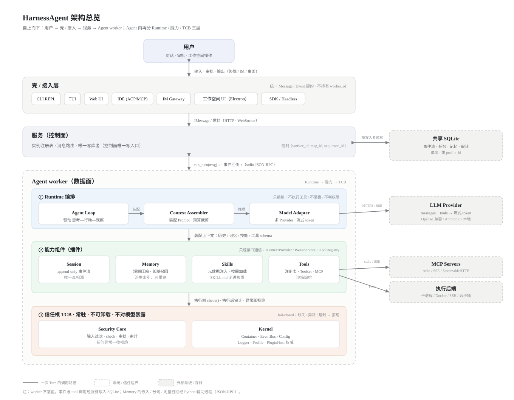
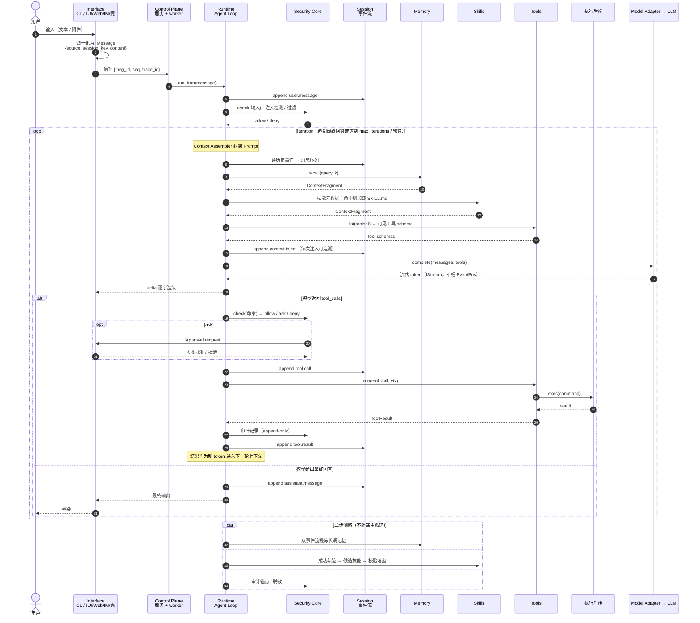
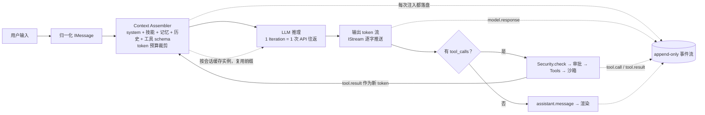

# 架构与数据流图

> 状态：草案｜依据 00-overview §5 与 01–10 各模块设计
> 说明：架构总览为静态 SVG（布局手工锁定，任何编辑器可直接显示）；时序与 token 流转为 Mermaid。

---

## 0. 绘图约定

| 约定 | 规则 |
|---|---|
| 一张图一件事 | 总览图回答"分几层、层间用什么协议"；时序图回答"一次 Turn 经过谁" |
| 元素数量 | 单图 ≤ 15 个元素；更深细节下钻到阶段对照表，不塞进图 |
| 箭头 | **单向**为主，标签写"做什么 + [协议]"；双向仅用于"请求 / 回传"同一通道 |
| 边界 | 用边框表达作用域与信任边界（虚线框 = 系统 / 信任边界） |
| 外部依赖 | 与本项目生命周期无关的（LLM、MCP、执行后端）用灰色虚线框区分 |
| 图例 | 每图配标题 + 读图说明；颜色不作唯一区分手段 |

参考：[C4 model — Notation](https://c4model.com/diagrams/notation)、[Mermaid C4 语法](https://mermaid.js.org/syntax/c4.html)。

---

## 1. 分层架构总览

**读图说明**

- **自上而下的四层**：用户 → 壳 / 接入 → 服务 → Agent worker；越往下越接近模型与执行。
- **壳 / 接入层只做适配**：统一转成 Message / Event，不持有 `worker_id`，不参与业务决策。
- **服务是唯一控制面**：实例注册表、消息路由、唯一写库者；worker 是数据面，**不直接落盘**。
- **Agent 内部分三层**：
  - ① **Runtime 编排**：Agent Loop 驱动 思考—行动—观察，Context Assembler 装配 Prompt 并裁剪预算，Model Adapter 负责多 Provider 与流式 token。
  - ② **能力组件（插件）**：Session（事件流）、Memory（召回 / 压缩）、Skills（渐进披露）、Tools（工具与沙箱编排），彼此只经接口通信。
  - ③ **信任根 TCB**：Security Core 与 Kernel 常驻、不可卸载、不对模型暴露；任何异常一律 fail-closed。
- **右侧外部依赖**：SQLite（单写入者）、LLM Provider（HTTPS / SSE）、MCP Servers（stdio / SSE）、执行后端（exec）。
- **箭头协议**：壳 → 服务为 HTTP / WebSocket；服务 → worker 为 stdio JSON-RPC；模型与 MCP 分别走 SSE 与 stdio。
- **未画进图**：Memory 的嵌入 / 中文分词 / 向量召回经 Python 辅助进程（JSON-RPC），见底部注释。

> 这张图是手工布局的 SVG（`architecture.svg`），改动时直接编辑矢量文件；Markdown 里只引用它，避免自动布局把线画乱。

---

## 2. 时序图：一次 Turn 的往返

---

## 3. Token 视角：token 经过了谁

**关键结论**

- **EventBus 不承载 token 流**：逐字输出走 `IStream`，否则每秒数百条事件会压垮订阅者（`01-kernel` §3.2）。
- **成本 = 迭代次数 × 累积上下文**：每轮 Iteration 都携带全部历史与工具结果；对策是并行工具调用、子代理隔离、前缀缓存、`max_iterations` 与预算（`02-runtime`）。
- **模型可见的一切都落盘**：system prompt、上下文注入、工具调用与结果、模型请求/响应全部是事件，`resume` / `fork` / `replay` 靠它重建。
- **Memory 是可重建的派生索引**，Session 事件流才是唯一真相源。

---

## 4. 阶段 ↔ 组件 ↔ 契约对照

| # | 阶段 | 组件 | 关键接口 / 事件 | token 影响 |
|---|---|---|---|---|
| 1 | 输入接入 | Interface | `IMessage {source, session_key, content}` | 用户输入 token |
| 2 | 路由到实例 | Control Plane | `ensure(profile)` · 信封 `{msg_id, seq, trace_id}` | 无 |
| 3 | 开启 Turn | Runtime | `IRuntime.run_turn(session, message)` | 无 |
| 4 | 记录输入 | Session | `append(user.message)` | 落盘 |
| 5 | 输入过滤 | Security | `check(action, ctx)` · 注入检测 | 无（可能截断） |
| 6 | 装配上下文 | Runtime + Session/Memory/Skills/Tools | `IContextProvider.collect()` · `recall()` · `list(toolset)` | **prompt token 主要来源** |
| 7 | 模型调用 | Model Adapter | `complete(messages, tools)` | prompt tokens 入、output tokens 出 |
| 8 | 流式输出 | Interface | `IStream`（非 EventBus） | 逐字渲染 |
| 9 | 工具判定 | Security | `check(命令)` → allow/ask/deny · L3 强制人类 | 无 |
| 10 | 工具执行 | Tools + 执行后端 | `IToolRunner.run()` · `IExecutionBackend.exec()` | 无 |
| 11 | 结果回灌 | Session → Context | `append(tool.result)` → 下一轮迭代 | **新增 token 进入下轮 prompt** |
| 12 | 最终回答 | Runtime + Session + Interface | `append(assistant.message)` · 渲染 | 输出 token |
| 13 | 异步沉淀 | Memory / Skills | `IMemoryProvider.write` · `SkillMiner.mine()` | 不阻塞对话 |

---

## 5. 与文档的对应关系

- 总体分层与信任边界：[`00-overview/design.md`](./design.md) §3
- 启动装配与一次对话链路：同文 §5.1 / §5.2
- 五类基础服务与 bootstrap：[`01-kernel/README.md`](../01-kernel/README.md) §3 / §5
- Turn / Iteration 与成本对策：[`02-runtime/README.md`](../02-runtime/README.md)
- 事件类型与唯一真相源：[`03-session/README.md`](../03-session/README.md)
- 壳 ↔ 服务 ↔ worker 与信封：[`10-control-plane/README.md`](../10-control-plane/README.md)
- 审批、fail-closed、L3：[`08-security/README.md`](../08-security/README.md) §3

**待定**（图未画死的部分）：子代理隔离级别（共享上下文 / 独立事件流）、Code Mode、CLI 单进程直连形态、安全 supervisor 进程——见各模块"待定问题"。
